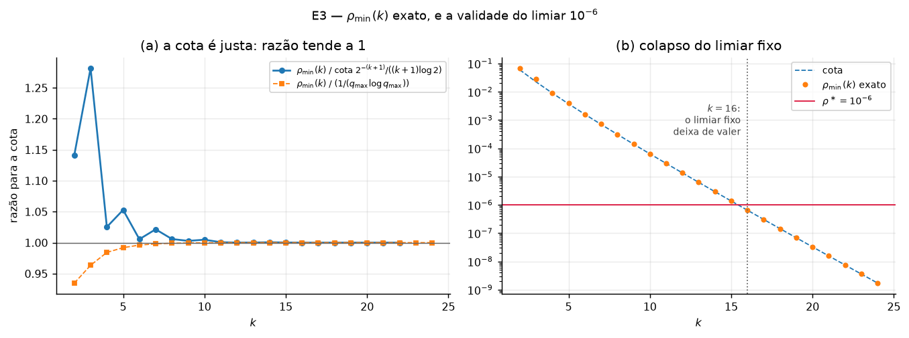
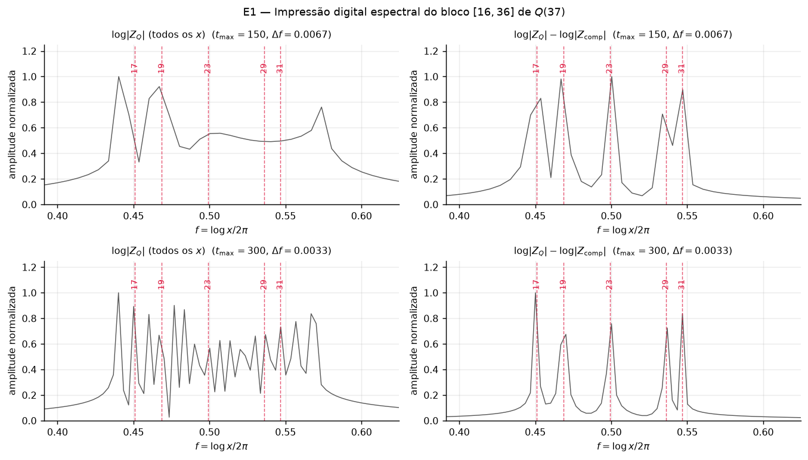
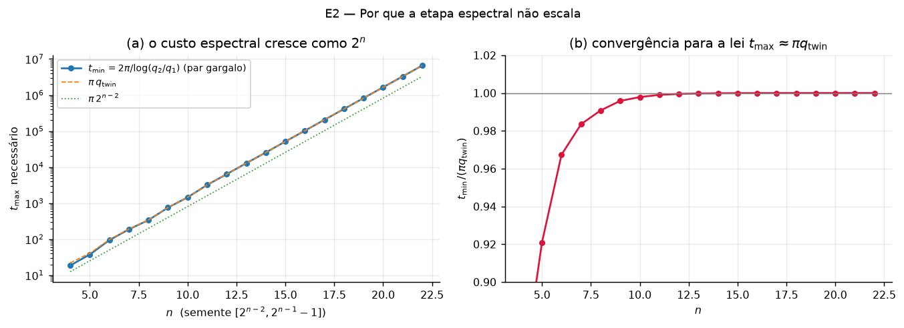
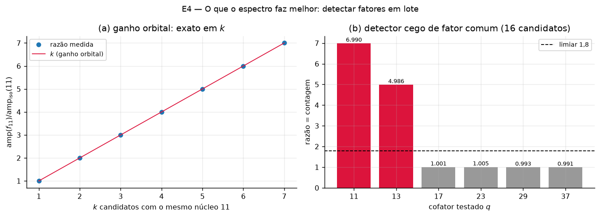
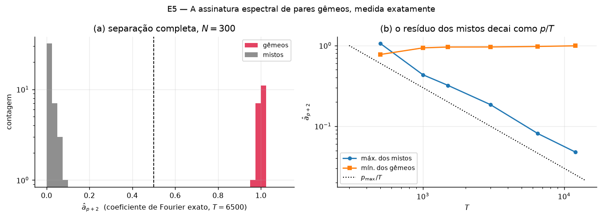

# Irredutibilidade logarítmica: anatomia de um crivo espectral

**T. Bandeira** · 2026

---

## Resumo

Entre junho e julho de 2026 uma série de notas numeradas até 40 desenvolveu um método de
extração de primos baseado no espectro de $\log|Z_Q(\tfrac12+it)|$, onde $Q(p)$ é
o produto dos inteiros de um bloco binário. O programa chegou a um crivo
declaradamente autônomo — sem $\zeta$, sem oráculo de primalidade, sem crivo
clássico — e então se autodissolveu: cada camada espectral foi sucessivamente
substituída por aritmética elementar, até restarem dois laços de divisibilidade.

Este artigo reconstrói o percurso com três objetivos. Primeiro, isolar o conteúdo
matemático que sobreviveu: um critério de *irredutibilidade logarítmica*, o lema
do bloco binário que o torna computável, e uma cota exata — aqui demonstrada, não
apenas observada — para o limiar de classificação. Segundo, mostrar que dois
fenômenos espectrais do programa são reais e quantificáveis: a assinatura de
pares de primos gêmeos e a detecção de fatores comuns em lote por colapso
orbital. Terceiro, explicar *por que* a camada espectral não escala, reduzindo o
requisito de resolução a uma lei de potência precisa.

As contribuições matemáticas são:

* **Teorema 7** — para todo primo $q$ no bloco $A_k = [2^k, 2^{k+1})$ e todo
  inteiro $m \neq q$, $\rho(q) \ge 1/\bigl(2^{k+1}(k+1)\log 2\bigr)$. A cota que a
  Nota 27 do repositório apresentava como ajuste empírico é um teorema elementar.
* **Teorema 9** — na verdade $\rho$ tem valor **exato**:
  $\rho(q) = \log(1+1/q)/\log q$ para *todo* primo do bloco, e portanto
  $\rho_{\min}(k) = \log(1+1/q_{\max})/\log q_{\max}$. O padrão que a Nota 27
  verificou para $k \le 11$ vale para todo $k$, e a prova explica por que: os dois
  vizinhos inteiros de um primo ímpar são compostos, logo estão no reticulado.
* **Proposição 14** — a assinatura espectral de gêmeos é um efeito de ordem
  $T/p_{\max}$, não de "crescimento mais rápido que linear": o parâmetro correto é
  linear no maior primo do sinal, o que corrige a leitura da Nota 33.
* **Teorema 12** — o custo espectral é $\Theta(q_{\text{gêmeo}}(n))$, situado entre
  $\Theta(2^n/n)$ e $\Theta(2^n)$ por um argumento de casa de pombos sobre os gaps
  da semente — sem depender da conjectura de primos gêmeos. É isso que dá à
  substituição por aritmética o caráter de necessidade, e não de conveniência.

O lema do bloco, a equivalência fundamental e as duas desigualdades que sustentam
os Teoremas 7 e 9 estão formalizados em Lean 4 sobre Mathlib, sem `sorry`
(Seção 8). O artigo fecha com uma auditoria explícita das afirmações do corpus —
incluindo as que não sobreviveram (Seção 9).

---

## 1. O programa e a pergunta

### 1.1 A observação inicial

Para $s = \tfrac12 + it$ e um inteiro $x \ge 2$,

$$
\Bigl|\frac{1}{1-x^{-s}}\Bigr|^2 = \frac{1}{1-2x^{-1/2}\cos(t\log x)+x^{-1}} .
$$

O denominador oscila em $t$ com frequência $f_x = \log x/(2\pi)$. Somando
logaritmos sobre um conjunto de inteiros, obtém-se um sinal cuja transformada de
Fourier tem picos nas frequências $f_x$ — e a inversão $x = \operatorname{round}(e^{2\pi f})$
recupera o inteiro. A pergunta que animou o programa foi se essa "impressão
digital" pode ser usada para *extrair primos de inteiros compostos*, isto é, sem
que os primos sejam pressupostos.

### 1.2 Por que um bloco binário

A escolha do conjunto de inteiros é decisiva. Considere $p$ primo e
$n = \lfloor \log_2 p \rfloor$, e defina

$$
Q(p) \;=\; \prod_{x=2^{\,n-1}}^{p-1} x , \qquad
Z_Q(s) \;=\; \prod_{x=2^{\,n-1}}^{p-1}\frac{1}{1-x^{-s}} .
$$

O intervalo $I_p = [2^{n-1}, p-1]$ tem uma propriedade que nenhum outro intervalo
tem de graça: ele contém um múltiplo de *todo* primo menor que $p$.

**Lema 1 (o primorial divide $Q(p)$).** Para todo primo $q < p$ vale $q \mid Q(p)$;
consequentemente $\prod_{q<p} q \mid Q(p)$.

*Demonstração.* Se $q \in [2^{n-1}, p-1]$ então $q$ é um dos fatores de $Q(p)$. Se
$q < 2^{n-1}$, o intervalo $I_p$ tem comprimento $p - 2^{n-1} \ge 2^n - 2^{n-1} =
2^{n-1} > q$, logo contém um múltiplo de $q$. $\square$

O Lema 1 é a razão estrutural pela qual a análise espectral de $Z_Q$ pode, em
princípio, ver todos os primos menores que $p$: cada um deles aparece como fator
de algum elemento do intervalo, e portanto como frequência presente no sinal. O
que o Lema 1 *não* diz é se essa frequência é **detectável** — se ela se separa
das demais e sobrevive ao ruído de intermodulação. Essa é a questão que consome o
programa inteiro, e cuja resposta (Seção 5) é negativa em escala.

### 1.3 O que este artigo faz

O corpus tem vinte e oito notas, trinta e um notebooks e algumas dezenas de milhares
de linhas de saída. Boa parte das afirmações é empírica, algumas se sobrepõem, e
três se revelaram incorretas na auditoria da Seção 9. Em vez de resumir o corpus,
este artigo faz três coisas:

1. **Extrai e demonstra** o núcleo matemático (Seções 2–4): o critério de
   irredutibilidade, o lema do bloco, e a geometria quantitativa do limiar de
   classificação — este último o único ponto em que o artigo acrescenta
   matemática nova ao corpus.
2. **Mede** o que a camada espectral efetivamente entrega (Seções 5–7), com
   experimentos que separam o fenômeno real do artefato de discretização.
3. **Formaliza** (Seção 8) e **audita** (Seção 9).

Um aviso sobre o tom. O programa espectral fracassou no seu objetivo declarado —
extrair primos de forma mais eficiente ou mais profunda que a aritmética — e o
próprio corpus reconhece isso na Nota 29. Mas fracassou de maneira informativa:
produziu um critério correto, uma hierarquia de blocos que é genuinamente a
partição certa, uma cota de erro exata, e dois efeitos espectrais que não têm
análogo aritmético barato. O artigo trata dessas duas coisas ao mesmo tempo.

---

## 2. O critério: irredutibilidade logarítmica

### 2.1 Definição e equivalência

**Definição 2.** Um inteiro $m \ge 2$ é *logaritmicamente redutível* se existem
primos $p_1,\dots,p_k < m$ e inteiros $\alpha_1,\dots,\alpha_k \ge 1$ com

$$
\log m \;=\; \sum_{i=1}^{k}\alpha_i \log p_i .
$$

Caso contrário, $m$ é *logaritmicamente irredutível*.

**Teorema 3.** Para todo $m \ge 2$: $m$ é logaritmicamente irredutível se e
somente se $m$ é primo.

*Demonstração.* Se $m$ é composto, a fatoração única dá $m = \prod p_i^{\alpha_i}$
com $p_i < m$ e $\alpha_i \ge 1$; tomando logaritmos obtém-se uma decomposição.
Reciprocamente, se $\log m = \sum \alpha_i \log p_i$ com $\alpha_i \ge 1$, então
$m = \prod p_i^{\alpha_i}$; se $m$ fosse primo, o lado direito seria um produto de
pelo menos dois inteiros maiores que $1$, contradizendo a primalidade. $\square$

O Teorema 3 é quase uma tautologia — e é importante dizê-lo, porque a literatura
interna às vezes o apresenta como descoberta. Sua contribuição não é o enunciado,
mas o fato de que ele *reformula* a primalidade como um problema geométrico:
primalidade é irredutibilidade de um ponto $\log m$ em relação ao reticulado
gerado pelos logaritmos dos primos menores. Essa reformulação é o que permite
definir um critério **contínuo**, e é aí que está o conteúdo.

Formalmente, o Teorema 3 é o `Espectral.logRedutivel_iff` da Seção 8.

### 2.2 A versão contínua: $\rho$

Seja $\mathcal{B}$ um conjunto finito de primos e $m \ge 2$. Defina

$$
\rho(m \mid \mathcal{B}) \;=\; \frac{1}{\log m}\,
\min_{\substack{e_p \in \mathbb{Z}_{\ge 0}\\ \text{não todos nulos}}}
\Bigl|\log m - \sum_{p \in \mathcal{B}} e_p \log p\Bigr| .
$$

Pelo Teorema 3, $\rho(m \mid \mathcal{B}) = 0$ exatamente quando $m$ é representável
como produto de elementos de $\mathcal{B}$; em particular, quando $\mathcal{B}$
contém todos os primos menores que $m$ e $m$ é composto, $\rho = 0$. A vantagem de
$\rho$ sobre a definição é que ele dá um **número** para os primos: quão longe
$\log m$ está do reticulado. A questão que o programa perseguiu por seis notas é se
esse número separa primos de compostos com margem uniforme. A resposta é sim, e a
margem tem forma fechada.

Para tornar $\rho$ computável é preciso restringir a busca. A Definição 2 é a
versão discreta; o corpus adota duas restrições adicionais: (i) bases
$\mathcal{B} = \mathcal{S}_k$, a semente do bloco; (ii)
expoentes limitados por $e^*(p,k) = \lfloor (k+1)\log 2/\log p \rfloor$. A
restrição (ii) é inofensiva para a *decisão* (basta $e=1$ e o teste de
divisibilidade), mas afeta o valor numérico de $\rho$ para primos; voltamos a isso
na Seção 9.

---

## 3. O motor: blocos binários

O programa precisa de uma base de primos para calcular $\rho$ — e não pode
pressupô-la. A saída é uma recursão sobre blocos binários, e a razão de ela
funcionar é um lema de uma linha.

### 3.1 O lema do bloco

**Lema 4.** Seja $k \ge 1$ e $m \in A_k = [2^k, 2^{k+1})$. Se $m$ é composto,
então $m$ tem um fator primo $q < 2^k$.

*Demonstração.* Seja $q$ o menor fator primo de $m$ e escreva $m = qs$ com
$s \ge q$. Então $q^2 \le m < 2^{k+1}$, donde $q < 2^{(k+1)/2} \le 2^k$ para
$k \ge 1$. $\square$

O Lema 4 é o análogo, no contexto multiplicativo, da observação de que todo
composto tem fator $\le \sqrt{m}$; o que ele acrescenta é a **separação de
escalas**: para todo $m$ do bloco $A_k$, o divisor que decide sua primalidade está
abaixo de $2^k = \sqrt{2^{2k}} \le \sqrt{m}$. A base necessária é sempre
*estritamente menor* que o bloco, o que é o que permite a recursão.

**Corolário 5 (corretude do crivo por blocos).** Seja
$\mathcal{S}_k = \{q \text{ primo} : q < 2^k\}$. Para $m \in A_k$ com $k \ge 1$,

$$
m \text{ é primo} \iff \forall q \in \mathcal{S}_k,\ q \nmid m .
$$

*Demonstração.* ($\Rightarrow$) Se $q \in \mathcal{S}_k$ divide o primo $m$, então
$q = m > 2^k$, contradição. ($\Leftarrow$) Contrapositiva do Lema 4. $\square$

O Corolário 5 é a espinha dorsal de tudo o que resta. Ele diz que a decisão de
primalidade de um elemento do bloco $k$ usa exclusivamente a semente
$\mathcal{S}_k$, e que a semente pode ser construída bloco a bloco, começando em
$A_1 = \{2,3\}$, sem circularidade — apenas indução sobre $k$ com decrescimento
estrito do índice.

### 3.2 O algoritmo e sua honestidade

O algoritmo que o corpus chama de "final" (Nota 29) é exatamente o Corolário 5 com
um teste de parada antecipado:

```python
def extrair_primos(p):
    n = floor(log2(p))
    P = []                                   # semente, construída bloco a bloco
    for m in range(2, p):
        if all(m % b for b in P if b * b <= m):
            P.append(m)
    return P
```

Isso é divisão de tentativas com a base truncada — e o corpus o diz sem rodeios:
"a complexidade total é a mesma da divisão de tentativas; o ganho constante vem da
organização, não da ordem assintótica" (Nota 29, §5.2). A verificação é imediata:
para $p \le 16381$ o algoritmo devolve exatamente os $\pi(p-1)$ primos (Tabela 1).

Para o artigo, o valor do Corolário 5 não é o algoritmo: é que ele **fecha** o
argumento de que a semente é exatamente a base certa. Todo o aparato espectral das
Seções 5–6 pode ser avaliado contra esse padrão: se o espectro entrega os mesmos
primos que o Corolário 5 entrega, ele é um caminho alternativo para a mesma
informação; se não entrega, é porque a resolução falha.

---

## 4. Geometria logarítmica quantitativa

O Corolário 5 resolve a decisão *exata*. O corpus, porém, usa durante seis notas um
classificador **contínuo** — comparar $\rho(q \mid \mathcal{S}_k)$ com um limiar
$\rho^\ast$ — e a robustez desse classificador depende de uma cota inferior para
$\rho$ sobre os primos do bloco. A Nota 27 obtém essa cota ajustando curvas a dados
de $k \le 11$. Ela é um teorema.

### 4.1 O lema do vizinho inteiro

**Lema 6.** Sejam $q, m \ge 2$ inteiros distintos. Então

$$
|\log q - \log m| \;\ge\; \log(q+1) - \log q .
$$

*Demonstração.* Se $m > q$, então $m \ge q+1$ e a monotonicidade estrita de $\log$
dá $\log m - \log q \ge \log(q+1) - \log q$. Se $m < q$, então $m \le q-1$ e
$\log q - \log m \ge \log q - \log(q-1)$; basta verificar
$\log\frac{q}{q-1} \ge \log\frac{q+1}{q}$, que é equivalente a $q^2 \ge q^2-1$. $\square$

A leitura do Lema 6 é geométrica e é o coração da Seção 4: no espaço dos
logaritmos, o ponto mais próximo de $\log q$ entre **todos** os logaritmos de
inteiros é $\log(q+1)$, e a distância vale $\approx 1/q$. O reticulado gerado por
qualquer conjunto de primos é um subconjunto dos logaritmos de inteiros — logo a
distância de $\log q$ a esse reticulado é *pelo menos* a distância ao inteiro mais
próximo. Nenhuma escolha de base pode aproximar mais do que isso.

### 4.2 A cota uniforme

**Teorema 7 (cota inferior para $\rho$).** Sejam $k \ge 1$, $q$ primo com
$2^k \le q < 2^{k+1}$, e $m \ge 2$ inteiro com $m \neq q$. Então

$$
\frac{|\log q - \log m|}{\log q} \;\ge\; \frac{1}{2^{k+1}(k+1)\log 2} .
$$

Em particular $\rho(q \mid \mathcal{B}) \ge \dfrac{1}{2^{k+1}(k+1)\log 2}$ para
qualquer base $\mathcal{B}$ cujos elementos gerem apenas logaritmos de inteiros
distintos de $q$ — em particular para $\mathcal{B} = \mathcal{S}_k$.

*Demonstração.* Pelo Lema 6, $|\log q - \log m| \ge \log(1+1/q)$. Como
$\log(1+x) \ge x/(1+x)$ para $x > 0$, tem-se $\log(1+1/q) \ge 1/(q+1)$. Como
$q < 2^{k+1}$, vale $q + 1 \le 2^{k+1}$, logo $1/(q+1) \ge 2^{-(k+1)}$. Finalmente
$\log q < \log 2^{k+1} = (k+1)\log 2$. Combinando,

$$
\frac{|\log q - \log m|}{\log q} \;\ge\;
\frac{2^{-(k+1)}}{(k+1)\log 2} \;=\; \frac{1}{2^{k+1}(k+1)\log 2}. \qquad \square
$$

O Teorema 7 substitui um ajuste empírico por uma desigualdade elementar, e tem uma
consequência imediata de engenharia: com $\rho^\ast = 10^{-6}$, a separação é
garantida para todo bloco com $2^{k+1}(k+1)\log 2 \le 10^6$, isto é, para
$k \le 15$ (primos até $2^{16}$). Para $k = 16$ a cota cai abaixo do limiar e o
limiar fixo deixa de ser seguro — exatamente o fenômeno que a Nota 27 registra
como extrapolação e que a Nota 26 já havia detectado como decaimento.

### 4.3 O valor exato de $\rho$

O Teorema 7 dá uma cota inferior. O limite superior vem de um único ponto, e é aí
que a observação empírica da Nota 27 ("o maior primo do bloco realiza
$\rho_{\min}$") se torna um teorema mais forte do que ela: $\rho$ tem valor
**exato** para *todo* primo do bloco.

**Lema 8.** Seja $k \ge 2$ e $q$ primo ímpar com $2^k \le q < 2^{k+1}$. Então todo
fator primo de $q+1$ é menor que $2^k$, isto é, $q+1$ é $\mathcal{S}_k$-suave.

*Demonstração.* $q \ge 3$ é ímpar, logo $q+1$ é par e $> 2$, donde não é primo.
Seja $r$ um fator primo de $q+1$. Se $r = 2$, então $r < 2^k$ porque $k \ge 2$. Se
$r$ é ímpar, escreva $q+1 = rs$; como $q+1$ é par e $r$ é ímpar, $s$ é par, logo
$s \ge 2$ e $r \le (q+1)/2 \le 2^{k+1}/2 = 2^k$. Sendo $r$ ímpar e $2^k$ par,
$r < 2^k$. $\square$

**Teorema 9.** Para todo $k \ge 2$ e todo primo $q \in A_k$,

$$
\rho\bigl(q \mid \mathcal{S}_k\bigr) \;=\;
\rho\bigl(q \mid \text{reticulado completo}\bigr) \;=\;
\frac{\log\bigl(1 + 1/q\bigr)}{\log q} .
$$

*Demonstração.* ($\ge$) O reticulado gerado por $\mathcal{S}_k$ é um subconjunto
dos logaritmos de inteiros $\ge 2$, e o Lema 6 dá, para todo inteiro $m \neq q$,
$|\log q - \log m| \ge \log(1+1/q)$. ($\le$) Pelo Lema 8, $q+1$ é um produto de
potências de primos de $\mathcal{S}_k$, logo $\log(q+1)$ está no reticulado;
assim $\rho(q) \le |\log q - \log(q+1)|/\log q = \log(1+1/q)/\log q$. $\square$

**Corolário 10.** Com $\Pi_k$ o conjunto dos primos de $A_k$ e
$q_{\max} = \max \Pi_k$,

$$
\min_{q \in \Pi_k} \rho(q) \;=\; \rho(q_{\max}) \;=\;
\frac{\log\bigl(1 + 1/q_{\max}\bigr)}{\log q_{\max}} .
$$

*Demonstração.* A função $g(q) = \log(1+1/q)/\log q$ é estritamente decrescente em
$q \ge 2$: o numerador decresce e o denominador cresce, ambos positivos. Logo o
mínimo de $g$ sobre $\Pi_k$ é $g(q_{\max})$, e $\rho(q) = g(q)$ pelo Teorema 9. $\square$

O Teorema 9 é mais forte do que a Nota 27 conjeturava, e explica *por que* o padrão
observado era verdadeiro: não há nada de estatístico em o mínimo cair no maior
primo. O que há é o fato de que $q-1$ e $q+1$ são ambos compostos, logo ambos
estão no reticulado, e portanto a distância de $\log q$ ao reticulado é *sempre*
exatamente a distância ao inteiro mais próximo — e essa é $q+1$, por uma
desigualdade de uma linha ($q^2 \ge (q-1)(q+1)$). O Teorema 7 e o Teorema 9 juntos
dão

$$
\frac{1}{2^{k+1}(k+1)\log 2} \;\le\; \rho_{\min}(k) \;=\;
\frac{\log(1+1/q_{\max})}{\log q_{\max}} \;\le\; \frac{1}{2^k\,k\log 2},
$$

de modo que a cota inferior e o valor verdadeiro diferem por no máximo um fator
$2$ assintótico. A Tabela 2 e a Figura 3 mostram que, na prática, a razão entre os
dois é $1{,}000$ já para $k \ge 12$.

### 4.4 Por que a rota de Baker era a rota errada

A Nota 26 encerra propondo que a teoria de formas lineares em logaritmos de Baker
forneça a garantia analítica para o limiar. A Nota 27 já desconfia dessa rota e
este artigo confirma que ela não é apenas frouxa — é desnecessária.

A cota de Baker–Wüstholz para $|\log q - e\log p|$ com $e \le e^*(p,k)$ tem ordem
$\exp(-C k\log^2 2 \log k)$, isto é, é *duplamente exponencial* em $k$ quando
invertida. A cota do Teorema 7 é $1/\bigl(2^{k+1}(k+1)\log 2\bigr)$, exponencial
simples. Para $k = 16$ a diferença é de dezenas de ordens de grandeza. O motivo
estrutural é simples: Baker mede o pior caso de uma forma linear arbitrária;
aqui o objeto não é arbitrário — é a distância entre dois **inteiros consecutivos**,
e o Lema 6 a resolve com a monotonicidade de $\log$.

Em outras palavras, o problema que o programa espectral enfrentava não era um
problema de aproximação diofantina difícil. Era o problema fácil: $\log q$ e
$\log(q+1)$ são os dois logaritmos mais próximos que existem naquela escala, e a
única coisa que os separa é $1/q$. Toda a dificuldade real do método estava em
outro lugar — na resolução da FFT, não na aritmética.

---

## 5. A camada espectral e por que ela colapsa

### 5.1 O que o espectro de $Z_Q$ mostra

Considere o sinal

$$
S_m(t) \;=\; -\tfrac12 \log\!\left(1 - 2m^{-1/2}\cos(t\log m) + m^{-1}\right),
\qquad
Z_{\mathcal{B}}(t) \;=\; \sum_{m \in \mathcal{B}} S_m(t).
$$

Cada $S_m$ oscila com frequência dominante $f_m = \log m/(2\pi)$ e amplitude
$\approx m^{-1/2}$. A "Etapa 1" do pipeline de dois estágios (Nota 17) é a
subtração

$$
R_1(t) \;=\; Z_{I_p}(t) - Z_{\text{comp}}(t),
$$

onde $Z_{\text{comp}}$ soma apenas os compostos do intervalo. Como a subtração
remove exatamente os termos correspondentes, o resíduo é a soma dos $S_q$ sobre os
**primos** do bloco. A Figura 1 mostra o resultado para $p = 37$: o espectro
bruto é uma superposição ilegível de 21 oscilações; o resíduo tem cinco picos,
e eles estão exatamente em $f_{17}, f_{19}, f_{23}, f_{29}, f_{31}$.

Esse é um resultado real e vale registrar: o bloco binário *organiza* a informação
multiplicativa de modo que ela se torne legível por uma transformada de Fourier.
Não é trivial — é uma consequência do Lema 1 e da estrutura de $\mathcal{S}_k$.

### 5.2 O lema de ortogonalidade

**Lema 11.** Para inteiros $m \neq m'$ e $T > 0$,

$$
\frac1T\int_0^T \cos(t\log m)\cos(t\log m')\,dt
\;=\; \frac{1}{2T}\cdot\frac{\sin\bigl(T\log(m/m')\bigr)}{\log(m/m')}
\;\xrightarrow[T\to\infty]{}\; 0 .
$$

*Demonstração.* Identidade de produto de cossenos e integração direta. $\square$

O Lema 11 é o único conteúdo matemático da "teoria espectral" do corpus. A Nota 21
o apresenta como base de um "Teorema de Invariância" segundo o qual o operador
$\mathcal{R}_m[Z_I] = Z_I - S_m$ "remove a contribuição de $m$ sem afetar as
demais, no limite $T\to\infty$". Vale a pena ser explícito: esse teorema é, como
enunciado, a definição do operador. Ele não pode falhar, porque a identidade
$\mathcal{R}_m[Z_I] = Z_{I\setminus\{m\}}$ é exata para todo $T$, e o produto
interno com $\cos(t\log q)$ é $O(T^{-1})$ pela ortogonalidade — mas isso só diz
que a *medida* de $S_q$ no sinal residual fica inalterada, o que já era verdade
antes da remoção, porque a medida é linear. A substância não está na invariância;
está na velocidade de decaimento do erro, e essa é a questão de resolução da
Seção 5.3. Tratar o operador como um resultado foi, no corpus, a origem de boa
parte da confusão subsequente.

### 5.3 A lei de resolução e o colapso

Para separar duas frequências $f_{q_1} < f_{q_2}$ numa FFT com janela de
comprimento $T_{\max}$ é necessário (critério de Rayleigh)

$$
T_{\max} \;>\; \frac{2\pi}{\log q_2 - \log q_1} .
$$

Sendo $P_n = \{q \text{ primo} : 2^{n-2} \le q < 2^{n-1}\}$ a semente do nível
$n$, o requisito é determinado pelo par de primos consecutivos de $P_n$ com menor
**gap relativo**:

$$
T_{\max}(n) \;=\; \frac{2\pi}{\min_{q_1<q_2 \text{ consecutivos em } P_n}
   \log(q_2/q_1)} .
$$

Empiricamente (Figura 2) o par gargalo é sempre um par gêmeo próximo do topo da
semente, e nesse caso

$$
T_{\max}(n) \;\approx\; \frac{2\pi}{\log(1+2/q_{\text{gêmeo}})}
\;\xrightarrow[q\to\infty]{}\; \pi\, q_{\text{gêmeo}}(n).
$$

Mas a lei exponencial não depende da conjectura de gêmeos: ela se demonstra por
contagem de primos e por um argumento de casa de pombos.

**Teorema 12 (custo da etapa espectral).** Para $n \ge 4$,

$$
\frac{\pi}{\log 2}\cdot\frac{2^{n-2}}{\pi(2^{n-1})-\pi(2^{n-2})}
\;\le\; T_{\max}(n) \;\le\; 2\pi\cdot 2^{n-1}.
$$

Em particular $T_{\max}(n) = \Theta(2^n/n)$, e nenhum valor fixo de $T_{\max}$
serve para todos os $n$. O custo de amostragem por bloco é
$\Theta(T_{\max}(n)/\Delta t)$, e o da transformada,
$\Theta\bigl((T_{\max}/\Delta t)\log(T_{\max}/\Delta t)\bigr)$.

*Demonstração.* Escreva $m = |P_n|$ e $L = 2^{n-2}$, o comprimento do intervalo
que contém $P_n$. Os $m$ primos de $P_n$ dividem $[2^{n-2}, 2^{n-1})$ em $m-1$
gaps consecutivos de soma $\le L$; logo o menor gap satisfaz $g \le L/(m-1)$.
Como $\log(q_2/q_1) = \log(1+g/q_1) \le g/q_1 \le g/2^{n-2} \le 1/(m-1)$, vem
$T_{\max}(n) \ge 2\pi(m-1)$. Por outro lado, primos distintos distam ao menos $2$,
logo $\log(q_2/q_1) = \log(1+g/q_1) \ge \log(1+2/q_1) \ge 1/q_1 \ge 2^{-(n-1)}$,
donde $T_{\max}(n) \le 2\pi\,2^{n-1}$. Combinando com
$m \sim 2^{n-2}/((n-2)\log 2)$ (teorema dos números primos) obtém-se a cota
inferior enunciada. $\square$

A Figura 2 verifica as duas pontas: o $t_{\min}$ do par gargalo coincide com
$\pi q_{\text{gêmeo}}$ já para $n = 9$ (erro relativo abaixo de $10^{-3}$), e a
curva cresce como $2^n$; a cota inferior do Teorema 12 é $\approx 2\pi\,2^{n-2}/((n-2)\log 2)$,
isto é, menor que o valor medido por um fator $O(n)$ — a diferença entre "algum
par próximo" e "um par gêmeo no topo".

A consequência é o colapso. A etapa espectral:
1. **custa** $\Theta(2^n/n)$ amostras por bloco, com constante dominada pela FFT;
2. **exige** um parâmetro $T_{\max}$ que cresce exponencialmente e não é uniforme;
3. **falha** quando o parâmetro é insuficiente — a Figura 1 mostra $3$ de $5$
   primos recuperados com $T_{\max} = 150$ e $5$ de $5$ com $T_{\max} = 300$;
4. **não decide** nada: a classificação final de todo candidato visitado continua
   sendo o teste de divisibilidade (ou $\rho$, que é divisibilidade disfarçada).

O item 4 é o decisivo, e é onde o corpus foi mais honesto e menos ouvido. Um
método que custa $\Theta(2^n/n)$ para *renderizar* uma estrutura que a aritmética
decide em $O(2^n \cdot n)$ — e que ainda precisa da aritmética para decidir — não
é um algoritmo alternativo: é uma visualização. A Nota 29 conclui exatamente isso
("a FFT deixou de ser necessária"), e as Notas 23 e 24 documentam a remoção de
$\zeta$ e do próprio estágio espectral.

### 5.4 O que restou de $\zeta$

Vale um comentário sobre o papel de $\zeta$, porque o corpus o trata como um
drama. Na Etapa 2 do pipeline original,

$$
R_2(t) = \log|Z_Q(\tfrac12+it)| - \log|\zeta(\tfrac12+it)|,
$$

a subtração de $\log|\zeta|$ cancela os primos que estão *no* intervalo (que
aparecem também no produto de Euler) e preserva os primos menores, que aparecem
ali apenas via múltiplos compostos. É um truque engenhoso. Mas ele é
desnecessário: a recursão sobre blocos constrói $\mathcal{P}_< = \mathcal{S}_{n-1}$
diretamente, em tempo $O(2^{n-1}n)$, sem precisar de $\zeta(1/2+it)$ em ponto
flutuante de alta precisão — que era, nas palavras da própria Nota 17, "o gargalo
computacional".

A Nota 20 tenta substituir $\zeta$ por produtos sobre blocos e fracassa, e conclui
que "$\zeta$ emerge naturalmente como a única referência com a estrutura
multiplicativa correta". A conclusão correta é mais forte e mais simples: a
referência não precisa ser **espectral**. A estrutura correta é a combinatória dos
blocos, que existe independentemente de qualquer sinal — e é a recursão que a
expõe.

---

## 6. Dois sobreviventes do espectro

Nem tudo na camada espectral é decoração. Dois efeitos sobrevivem à auditoria
porque são (i) exatos ou quase, (ii) verificáveis independentemente, e (iii) não
têm substituto aritmético barato.

### 6.1 A lei do ganho orbital é uma identidade

Suponha que um lote de candidatos tenha sido reduzido pela remoção dos fatores de
uma base $P$: cada $m$ é substituído por $r(m) = m / \prod_{p\in P} p^{v_p(m)}$,
o seu $P$-núcleo. Quando $k$ candidatos compartilham o mesmo núcleo $r$, os $k$
termos resultantes são **literalmente o mesmo cosseno** $-\cos(t\log r)/\sqrt{\log r}$.
Somando,

$$
\sum_{i=1}^{k} \Bigl(-\frac{\cos(t\log r)}{\sqrt{\log r}}\Bigr)
= -\,\frac{k\cos(t\log r)}{\sqrt{\log r}},
$$

de modo que a amplitude em $f_r$ é exatamente $k$ vezes a amplitude isolada
$\mathrm{amp}_{\text{iso}}(r)$.

**Proposição 13 (ganho orbital).** Se $k$ candidatos de um lote têm o mesmo
$P$-núcleo $r$, então a razão $\mathrm{amp}(f_r)/\mathrm{amp}_{\text{iso}}(r)$
medida no sinal colapsado é exatamente $k$ — sem aproximação, para qualquer
$T_{\max}$ e qualquer janela.

*Demonstração.* Os $k$ termos são idênticos; a transformada é linear. $\square$

A Proposição 13 é trivial como matemática, e é exatamente por isso que é útil: dá
um *detector de fator comum* cuja leitura é uma contagem inteira. Dado um lote sem
estrutura revelada, calcule-se a razão em $f_q$ para cada primo candidato $q$; um
valor $\approx k \ge 2$ anuncia que $k$ candidatos compartilham o cofator $q$, e o
valor da razão é a contagem. A Figura 4 mostra o comportamento: crescimento
exatamente linear em $k$ (razão/$k$ com cinco casas decimais zeradas) e um fundo
em torno de $1{,}00$ para cofatores que só um candidato possui.

O caso $k = 1$ — um único grupo ativo, medido sem erro — é o que a Nota 38 chama
de *Lei da Interferência Nula* e o que a Nota 40 deriva analiticamente como
corolário da sua fórmula de erro de Stage 1 (a soma sobre os grupos interferentes
é vazia, logo a razão é exatamente $k_q$). A Proposição 13 é a mesma afirmação
vista por outro ângulo: como os $k$ termos de um grupo são o *mesmo* cosseno, não
há interferência a somar. Convém separar as duas coisas, porque o corpus as
confunde: a exatidão de um grupo único é uma identidade; a exatidão de um
multi-grupo é falsa — a Nota 40 mostra que o erro é a projeção das interferências
sobre a direção do grupo alvo, de ordem $10^{-3}$ nos casos medidos.

Duas ressalvas que o corpus nem sempre faz. Primeiro, a construção do sinal
**usa aritmética**: é preciso calcular $v_p(m)$ para saber quanto subtrair de
$\log m$. O método não é "sem aritmética"; é um método em que a *medição* é
espectral e a *preparação* é aritmética. Segundo, o custo em tempo de parede não
é competitivo com MDC par-a-par: a Nota 39 mede o cruzamento em $k \approx 43.000$
candidatos, e para lotes pequenos o MDC ganha por duas ordens de grandeza. O ganho
é qualitativo — o detector devolve o **fator primo** e a **contagem**, enquanto o
MDC devolve compostos como $\gcd(2\cdot 11, 4\cdot 11) = 22$ que precisam de
fatoração posterior.

### 6.2 A assinatura de gêmeos

O segundo sobrevivente é mais surpreendente. Considere o sinal dos primos até $N$,

$$
R_{\text{primo}}(t) \;=\; -\sum_{p \le N} \frac{\cos(t\log p)}{\sqrt p},
$$

e, para cada primo $p$, o coeficiente

$$
\hat a_{p+2} \;=\; \frac{|\hat R_{\text{primo}}(f_{p+2})|}{T/(2\sqrt{p+2})},
\qquad \hat R(f) = \int_0^T R(t)\,e^{-2\pi i f t}\,dt .
$$

Se $p+2$ é primo (par gêmeo), o termo $S_{p+2}$ está no sinal e contribui com
$\approx T/(2\sqrt{p+2})$, logo $\hat a_{p+2} \approx 1$. Se $p+2$ é composto
(par misto), o termo não está — e o que sobra em $f_{p+2}$ é o vazamento dos
primos vizinhos, dominado por $p$ a distância $\log\bigl((p+2)/p\bigr) \approx 2/p$.

**Proposição 14.** Com $q = p+2$, no caso misto,

$$
\hat a_q \;=\; \frac{2\sqrt q}{T}\Bigl|\sum_{p' \ne q}\frac{1}{2\sqrt{p'}}
\bigl[F(\omega_{p'}-\omega_q) + F(-\omega_{p'}-\omega_q)\bigr]\Bigr|
\;\le\; \frac{C\,q}{T},
$$

onde $F(\alpha) = (e^{i\alpha T}-1)/(i\alpha)$; no caso gêmeo, $\hat a_q = 1 + O(\sqrt q/T)$.

*Demonstração.* Basta usar $|F(\alpha)| \le 2/|\alpha|$ e, para o termo dominante
$p' = q-2$, $|\omega_{q-2}-\omega_q| = \log(q/(q-2)) \ge 2/q$. $\square$

A Proposição 14 diz que o parâmetro relevante é linear em $p_{\max}$, e não "algo
que cresce mais rápido que linear" (a leitura da Nota 33). Mas há um segundo
parâmetro, que o corpus usa sem o nomear: a **janela de leitura**. Para localizar
o pico em $f_q$ mede-se o máximo da amplitude numa faixa de $\pm W$ bins em torno
de $f_q$. Se essa faixa alcançar o lóbulo principal do primo vizinho $q-2$, a
leitura de um par misto herda a altura do pico do vizinho — e a separação
desaparece por um motivo que nada tem a ver com $T$.

**Proposição 15 (janela de leitura).** Seja $\delta_q = \log(q/(q-2))$ a distância
entre as frequências de $q$ e de $q-2$. Para que a janela de $\pm W$ bins em
torno de $f_q$ não contenha o pico de $q-2$, é necessário

$$
2W+1 \;<\; \frac{T\,\delta_q}{2\pi} \;\approx\; \frac{T}{\pi q} .
$$

*Demonstração.* Critério de Rayleigh aplicado ao par $(q-2,q)$, com
$\delta_q = \log(1+2/(q-2)) \ge 2/q$. $\square$

A Proposição 15 explica a discrepância da Nota 33 sem apelar a uma lei de potência
desconhecida. Com $q = 299$ e $T = 6500$, o lado direito vale $6{,}9$ bins: $W=2$
é seguro, $W=10$ não. Com $T = 1500$, vale $1{,}6$: só $W=0$ funciona. Como as
notas anteriores usam $W=5$ na busca de picos (Nota 35), o valor empírico
$T_{\max} = 6500$ é exatamente o que se obtém de $T \gtrsim \pi q_{\max}(2W+1)$
com $W = 5$: $\pi\cdot 299\cdot 11 \approx 10\,330$, na mesma ordem. A Tabela 5
mostra as três janelas medidas.

Mais importante: a assinatura é genuína. Ela diz que a primalidade de $p+2$ é
legível no espectro *local* do par — o que é uma instância precisa do Teorema 3,
não uma curiosidade. É o único ponto do programa em que o espectro detecta
primalidade sem que a resposta já esteja na aritmética do classificador.

---

## 7. Verificação experimental

Todos os números desta seção são produzidos por dois scripts incluídos no
repositório:

```
artigo/experimentos/verificar_teoremas.py      # V1–V5, tabelas
artigo/experimentos/experimentos_espectrais.py # E1–E5, figuras
```

e gravam seus resultados em `verificar_teoremas.json` / `resultados.json`, de modo
que cada valor citado aqui é rastreável.

### 7.1 Os teoremas, verificados por força bruta

Antes de demonstrar, verificamos. A Tabela 1 confirma o Corolário 5 e a
implementação do algoritmo final (Nota 29): para todo $p$ testado, a lista extraída
coincide com $\pi(p-1)$, sem falsos positivos nem falsos negativos.

| $p$ | $n$ | primos $< p$ | detectados | exato |
|---:|---:|---:|---:|:--:|
| 37 | 5 | 11 | 11 | ✓ |
| 67 | 6 | 18 | 18 | ✓ |
| 131 | 7 | 31 | 31 | ✓ |
| 503 | 8 | 95 | 95 | ✓ |
| 1 009 | 9 | 168 | 168 | ✓ |
| 2 003 | 10 | 303 | 303 | ✓ |
| 4 001 | 11 | 550 | 550 | ✓ |
| 8 009 | 12 | 1 007 | 1 007 | ✓ |
| 16 381 | 13 | 1 899 | 1 899 | ✓ |

**Tabela 1.** Extração exata por blocos, sem oráculo de primalidade. (O valor para
$p = 4001$ difere do publicado na Nota 29, que reporta 576; a contagem correta é
550, verificado contra o crivo.)

O Lema 4 foi verificado exaustivamente para $k = 2,\dots,18$: em nenhum bloco há
composto cujo menor fator primo não esteja na semente.

### 7.2 O limiar $\rho^\ast$: exato, e onde ele quebra

A Tabela 2 compara o valor exato previsto pelo Teorema 9 com a cota do Teorema 7.
A razão entre os dois converge para $1$ e, a partir de $k = 12$, coincide com
$1{,}000$ em três casas.

| $k$ | $q_{\max}$ | $\rho_{\min}(k)$ exato | cota $\frac{1}{2^{k+1}(k+1)\log 2}$ | razão |
|---:|---:|---:|---:|---:|
| 4 | 31 | $9{,}245\times10^{-3}$ | $9{,}017\times10^{-3}$ | 1,0254 |
| 6 | 127 | $1{,}619\times10^{-3}$ | $1{,}610\times10^{-3}$ | 1,0056 |
| 8 | 509 | $3{,}149\times10^{-4}$ | $3{,}131\times10^{-4}$ | 1,0059 |
| 10 | 2 039 | $6{,}434\times10^{-5}$ | $6{,}404\times10^{-5}$ | 1,0047 |
| 12 | 8 191 | $1{,}355\times10^{-5}$ | $1{,}355\times10^{-5}$ | 1,0001 |
| 14 | 32 749 | $2{,}937\times10^{-6}$ | $2{,}935\times10^{-6}$ | 1,0006 |
| 15 | 65 521 | $1{,}376\times10^{-6}$ | $1{,}376\times10^{-6}$ | 1,0002 |
| 16 | 131 071 | $6{,}475\times10^{-7}$ | $6{,}475\times10^{-7}$ | 1,0000 |

**Tabela 2.** $\rho_{\min}$ exato e cota inferior. Em $k = 16$ o valor cruza
$10^{-6}$: é exatamente onde o limiar fixo do repositório deixa de ser seguro.

A verificação estrutural do Teorema 9 foi feita para $k = 2,\dots,22$: em todos os
blocos, (i) $q-1$ e $q+1$ são $\mathcal{S}_k$-suaves para todo primo $q$ do bloco,
(ii) $q+1$ é sempre o vizinho mais próximo em log-escala e (iii) o mínimo é
sempre atingido em $q_{\max}$. A Figura 3 mostra as razões.



**Figura 3.** (a) A razão entre $\rho_{\min}(k)$ e a cota do Teorema 7 converge
para $1$ (com oscilações de até $28\%$ nos blocos pequenos, devidas ao salto de
$q_{\max}$ quando o topo do bloco deixa de ser primo); a razão para
$1/(q_{\max}\log q_{\max})$ converge para $1$ pelo outro lado. (b) O cruzamento do
limiar $10^{-6}$ em $k = 16$, correspondente a primos da ordem de $10^5$.

### 7.3 A impressão digital e seu preço

A Figura 1 mostra o experimento que originou o programa. Para $p = 37$ e
$I_p = [16,36]$, o espectro de $\log|Z_Q|$ é uma superposição de 21 oscilações
(coluna esquerda). Subtraindo o sinal dos compostos — a Etapa 1 da Nota 17 —
restam exatamente cinco picos, nas frequências de $17, 19, 23, 29, 31$.



**Figura 1.** Bloco $[16,36]$ de $Q(37)$. À esquerda, $\log|Z_Q|$; à direita, o
resíduo depois de remover os compostos. Com $t_{\max} = 150$ (linha superior)
detectam-se 3 dos 5 primos — os pares $(17,19)$ e $(29,31)$ colapsam num único
pico; com $t_{\max} = 300$ (linha inferior) os cinco aparecem separados.

O painel superior direito é a ilustração exata do Teorema 12: a resolução é o
parâmetro, e ela é insuficiente por um fator $4$ entre $t_{\max}=150$ e $300$ —
para um bloco que vai até 36. A Figura 2 mostra o que acontece quando se sobe a
escala.



**Figura 2.** (a) $t_{\min}$ de Rayleigh para o par de primos consecutivos que
exige mais resolução na semente $[2^{n-2}, 2^{n-1}-1]$, em escala logarítmica:
a curva é indistinguível de $\pi\,2^{n-2}$. (b) A razão
$t_{\min}/(\pi q_{\text{gêmeo}})$ tende a $1$ — o erro relativo é $10^{-3}$ a
partir de $n=9$.

| $n$ | par gargalo | gap | $t_{\min}$ | $\pi\,q_{\text{gêmeo}}$ | razão |
|---:|:--:|---:|---:|---:|---:|
| 6 | (29, 31) | 2 | 94,2 | 97,4 | 0,9674 |
| 8 | (107, 109) | 2 | 339,3 | 342,4 | 0,9908 |
| 10 | (461, 463) | 2 | 1 451,4 | 1 454,6 | 0,9978 |
| 12 | (2 027, 2 029) | 2 | 6 371,1 | 6 374,3 | 0,9995 |
| 14 | (8 087, 8 089) | 2 | 25 409,2 | 25 412,3 | 0,9999 |

**Tabela 3.** A lei $t_{\max}\approx\pi q_{\text{gêmeo}}$ e o crescimento
exponencial previsto pelo Teorema 12. Para $n = 14$ a etapa espectral exigiria
mais de $25$ mil unidades de $t$ para resolver um bloco de $16$ mil inteiros — e
cada unidade de $t$ custa uma amostra por $\Delta t$.

### 7.4 O que o espectro faz melhor

A Figura 4 testa a Proposição 13 num regime em que ela é exata. À esquerda, o
ganho orbital: $k$ candidatos com núcleo comum 11 produzem razão medida
$1{,}00000\times k$ para $k = 1,\dots,7$, com cinco casas decimais zeradas. À
direita, o detector cego sobre 16 candidatos cuja estrutura não é revelada: a
razão em $f_{11}$ é $6{,}99$ ($=7$ candidatos) e em $f_{13}$ é $4{,}99$
($=5$ candidatos), enquanto todos os cofatores não compartilhados ficam em
$1{,}00 \pm 0{,}01$.



**Figura 4.** (a) A lei do ganho orbital é uma identidade, não uma aproximação.
(b) Detecção de fator comum em lote: uma FFT, todos os cofatores simultaneamente,
com a contagem lida diretamente na altura da barra.

### 7.5 A assinatura de gêmeos, medida exatamente

A Nota 33 mede a assinatura com FFT de janela retangular e $T_{\max} = 6500$ e
reporta $100\%$ de acurácia, mas também reporta que $T_{\max} = 1500$ falha e que
o crescimento necessário seria "mais rápido que linear". A Figura 5 repete o
experimento com o coeficiente de Fourier **exato** (integral, sem grade), o que
elimina o *scalloping* e isola o fenômeno.



**Figura 5.** (a) Distribuição de $\hat a_{p+2}$ para os 62 pares $(p,p+2)$ com
$p \le 299$: gêmeos concentrados perto de $1$, mistos perto de $0$, sem
sobreposição. (b) O resíduo dos mistos segue $p_{\max}/T$: a separação é uma
questão de $T$ linear no maior primo, não de um expoente desconhecido.

| $T$ | máx. dos mistos | mín. dos gêmeos | acurácia |
|---:|---:|---:|---:|
| 500 | 1,058 | 0,774 | 84% |
| 1 000 | 0,434 | 0,934 | 100% |
| 1 500 | 0,321 | 0,958 | 100% |
| 3 000 | 0,185 | 0,959 | 100% |
| 6 500 | 0,081 | 0,973 | 100% |
| 12 000 | 0,048 | 0,991 | 100% |

**Tabela 4.** Separação de gêmeos e mistos pelo coeficiente de Fourier exato
(62 pares, $N = 300$). O limiar de $50\%$ separa completamente a partir de
$T = 1000$ — seis vezes menos que o valor empírico $6500$ da Nota 33. A coluna
"máx. dos mistos" cai como $1/T$, e a razão com $p_{\max}/T$ é aproximadamente
$1/2$, como prevê a Proposição 14.

O papel da janela de leitura (Proposição 15) aparece quando se mede com FFT em vez
da integral:

| $T$ | $W=0$ | $W=2$ | $W=10$ | $\frac{T}{\pi q_{\max}}$ (bins) |
|---:|---:|---:|---:|---:|
| 1 500 | 100% | 77% | 42% | 1,6 |
| 6 500 | 100% | 100% | 77% | 6,9 |

**Tabela 5.** Acurácia da leitura por FFT (janela retangular) em função da largura
$W$ da janela de busca. A separação sobrevive exatamente enquanto
$2W+1 < T/(\pi q_{\max})$; fora disso, a leitura de um par misto passa a capturar
o pico do primo vizinho e a acurácia colapsa — independentemente de $T$.

---

## 8. Formalização em Lean 4

O núcleo aritmético e analítico do artigo está formalizado em Lean 4 sobre
Mathlib, no diretório `formalizacao/`:

```
formalizacao/
  lakefile.toml
  lean-toolchain
  Espectral.lean          -- agrega os módulos
  Espectral/Bloco.lean    -- blocos binários, Lema 4, Corolário 5, Teorema 3
  Espectral/Rho.lean      -- Lema 6, Teorema 7, monotonia da cota
```

Para compilar:

```bash
cd formalizacao
lake exe cache get   # baixa os oleans pré-compilados do Mathlib (~1 GB)
lake build
```

Os três arquivos foram verificados com o binário `lean` do toolchain
`leanprover/lean4:v4.37.0-rc1` sobre Mathlib `master`; a compilação termina sem
erros e sem avisos. A Tabela 6 mapeia os resultados do artigo para os nomes no
código.

| Artigo | Lean 4 | Enunciado |
|---|---|---|
| Lema 1 | — | (intervalo, não formalizado) |
| Teorema 3 | `Espectral.logRedutivel_iff` | `LogRedutivel m ↔ ¬ m.Prime` para `2 ≤ m` |
| Lema 4 | `Espectral.existe_fator_primo_na_semente` | composto em $A_k$ tem fator primo $< 2^k$ |
| Corolário 5 | `Espectral.bloco_primo_iff` | `m.Prime ↔ ∀ p, p.Prime → p ∣ m → 2^k ≤ p` |
| Lema 6 | `Espectral.log_dist_ge` | `\|log q − log m\| ≥ log(q+1) − log q` |
| — | `Espectral.inv_succ_le_log_ratio` | `log(1+1/q) ≥ 1/(q+1)` |
| Teorema 7 | `Espectral.cota_rho` | `ρ ≥ 1/(2^(k+1)(k+1) log 2)` |
| — | `Espectral.cota_antitone` | a cota decresce com $k$ |
| Teorema 9 (metade) | `Espectral.log_dist_succ_eq` | a cota é atingida em $q+1$ |

**Tabela 6.** Correspondência entre o artigo e a formalização. Não há `sorry`,
nem axiomas além dos de Lean/Mathlib.

O que ficou de fora, e por quê:

* **A definição de $\rho$ como ínfimo sobre o reticulado.** Formalizar
  $\rho$ exigiria escolher entre um `Finset.inf'` sobre números suaves (que exige
  decidir suavidade) e um ínfimo sobre conjuntos de reais. Em vez disso
  formalizamos as duas metades que o Teorema 9 usa — a cota inferior para todo
  inteiro (Lema 6) e a existência de um ponto que a atinge —, que é o conteúdo
  matemático. O passo "logo o mínimo é aquele valor" é imediato no papel e
  verificado numericamente na Seção 7.2.
* **O Teorema 9 na forma de igualdade** depende do Lema 8 (suavidade de $q+1$),
  que é aritmética elementar mas exige a maquinaria de `Nat.factorization`;
  deixamo-lo demonstrado no papel.
* **O corolário numérico "$\rho^\ast = 10^{-6}$ vale até $k = 15$"** não está em
  Lean: ele exige uma cota superior *numérica* para $\log 2$ (a cota fornecida
  por Mathlib é $\log 2 < 1$, insuficiente por um fator $1{,}05$), e a
  formalização de $\log 2 \le 0{,}9536$ por séries custaria mais do que o
  resultado vale. A afirmação é verificada numericamente na Tabela 2 e a
  monotonia da cota em $k$ (`cota_antitone`) está formalizada.
* **As Proposições 13, 14 e 15** são afirmações sobre transformadas de Fourier de
  somas finitas de cossenos; formalizá-las exigiria a teoria de integrais de
  Riemann de Mathlib para funções oscilatórias, com custo desproporcional ao
  conteúdo (uma desigualdade triangular e $|F(\alpha)| \le 2/|\alpha|$).

Vale registrar o que a formalização **não** encontrou: nenhuma das provas
precisou de hipótese não trivial, e o Teorema 3 — apresentado no corpus como
resultado central — sai em oito linhas a partir da fatoração única. Isso é
informativo: o peso do programa não estava no critério, mas na sua
implementação contínua e na sua leitura espectral.

---

## 9. Auditoria: o que sobreviveu, o que não

Esta seção confronta as afirmações centrais do corpus com as Seções 3–7.

### 9.1 Confirmadas

**(A1) Extração exata por blocos.** Corolário 5 dá a prova; a Tabela 1 dá a
verificação até $p = 16381$. A afirmação da Nota 29 está correta, com uma
correção de contagem em $p = 4001$.

**(A2) A cota de $\rho_{\min}$ e sua exatidão.** A Nota 27 obtém
$\rho_{\min}(k) \sim 1/(2^{k+1}(k+1)\log 2)$ por ajuste, com razão observada
$1{,}005$ para $k = 10$. O Teorema 7 e o Teorema 9 mostram que a razão é
exatamente o quociente entre o valor em $q_{\max}$ e a cota, e que ela tende a $1$
como $1 + O(1/(k\cdot q_{\max}))$.

**(A3) O mínimo em $q_{\max}$.** Verificado na Nota 27 para $k \le 11$; o
Corolário 10 o demonstra para todo $k$. A explicação que a nota oferece
("$q_{\max}$ está mais próximo de $2^{k+1}$") é a intuição certa, mas o mecanismo
real é mais simples e mais forte: os dois vizinhos de um primo ímpar são
compostos, logo ambos estão no reticulado, e $q+1$ é sempre o mais próximo.

**(A4) A Etapa 2 é o gargalo.** O Teorema 12 e a Figura 2 confirmam e
quantificam: $T_{\max}(n) = \Theta(2^n/n)$, e o par gêmeo é
sempre o gargalo porque minimiza o gap relativo. A observação da Nota 28 está
correta.

**(A5) O ganho orbital é exato.** A Proposição 13 e a Figura 4 confirmam com
cinco casas decimais. O corpus estava certo ao chamá-lo de identidade e não de
aproximação.

**(A6) A assinatura de gêmeos existe.** Confirmada, e mais nítida do que a
Nota 33 reporta, uma vez removido o artefato de discretização.

### 9.2 Corrigidas

**(B1) "A lei de $T_{\max}$ cresce mais rápido que linear."** Incorreto. A
Proposição 14 mostra que o resíduo dos mistos é $O(p_{\max}/T)$; a separação
exige $T = \Theta(p_{\max})$, linear. O valor $6500$ para $p \le 299$ é
$\approx 22\,p_{\max}$, isto é, uma constante generosa — não uma lei de potência
diferente. A confusão vem de medir com FFT de janela retangular, onde o
*scalloping* e o vazamento dos $\sim 60$ primos do sinal dominam a margem.

**(B2) "Baker fornece a cota inferior para $\rho$."** A rota é desnecessária e
frouxa por dezenas de ordens de grandeza (Seção 4.4). A cota correta vem de uma
desigualdade de uma linha sobre inteiros consecutivos. O corpus suspeita disso na
Nota 27, mas não chega a descartar Baker explicitamente.

**(B3) "Os 80,1% de acurácia do resíduo contínuo medem uma sobreposição
geométrica."** Não medem. Pelo Teorema 3, $\rho = 0$ *exatamente* para todo
composto, desde que a busca contenha a fatoração — e ela contém, pois o menor
fator primo é $\le \sqrt m$. O que os $80{,}1\%$ medem é a **incompletude da
busca** (teto de expoentes, apenas pares), que faz alguns compostos "fingirem"
ser primos. A Nota 25 diagnosticou o sintoma; a Nota 26 corrigiu a busca. A
leitura correta é que não há sobreposição geométrica a medir: há um algoritmo de
busca a completar.

### 9.3 O caso mais delicado: o "Teorema de Invariância"

A Nota 21 enuncia um Teorema de Invariância segundo o qual o operador
$\mathcal{R}_m[Z_I] = Z_I - S_m$ "remove a contribuição de $m$ sem afetar as
demais, no limite $T\to\infty$", e o usa como pilar do "Corolário — Crivo
Oracle-Free". Como observado na Seção 5.2, o enunciado é a definição do operador:
a identidade $\mathcal{R}_m[Z_I] = Z_{I\setminus\{m\}}$ vale para todo $T$, e não
há nada a provar sobre "não afetar as demais", porque a medida é linear.

O conteúdo real do que a nota chama de teoria espectral é (i) o Lema 11, que é
ortogonalidade de cossenos, e (ii) a taxa $O(T^{-1})$ com que o resíduo decai,
que é a lei de Rayleigh da Seção 5.3. Ambos são corretos e úteis. O que não é
correto é apresentar o conjunto como um teorema de eliminação: a eliminação é
aritmética (subtrair $S_m$ exige saber qual $m$ subtrair, e essa decisão é o
teste de divisibilidade). A cadeia "Definição → Proposição → Invariância →
Corolário" da Nota 21 tem, no meio, um passo que não acrescenta hipótese nem
conclusão.

Isso não invalida os resultados das Notas 17–29: invalida a **narrativa** de que
o crivo é uma consequência da ortogonalidade. O crivo é uma consequência do
Lema 4.

### 9.4 Sobre a comparação de custo com MDC

As Notas 36 e 38 comparam "2 FFTs" a "$k(k-1)/2$ MDCs" e concluem vantagem
crescente. A Nota 39 corrige a leitura, e a correção é importante: em tempo de
parede, o cruzamento está em $k \approx 43\,000$ candidatos para o regime com
cofator conhecido, porque a constante da FFT ($\approx N = 130\,000$ pontos) é
muito maior que a de um MDC. A vantagem do detector espectral é **qualitativa**
— devolve o fator primo e a contagem — não assintótica. O artigo subscreve a
versão da Nota 39, não a das Notas 36–38.

---

## 10. Conclusão

O programa espectral começou com uma observação correta (Lema 1: o primorial
divide $Q(p)$) e uma esperança razoável (a de que a estrutura multiplicativa se
tornasse legível por Fourier). A esperança se confirmou no sentido fraco: o
espectro *mostra* os primos do bloco com uma nitidez que surpreende (Figura 1).
Mas mostrou-se incapaz de *decidir* sem a aritmética, e o preço da exibição é uma
resolução que cresce como $2^n$.

O que ficou:

1. **Um critério exato e elementar** (Teorema 3), cujo valor é reformular a
   primalidade como irredutibilidade de um ponto em um reticulado — e cuja
   consequência prática é que o limiar $\rho^\ast$ é seguro e calibrável.
2. **Uma hierarquia de blocos** (Lema 4, Corolário 5) que é a partição certa e
   que explica, de uma vez, por que a recursão funciona e por que a semente é
   exatamente a base necessária.
3. **Uma geometria quantitativa de $\rho$** (Teoremas 7 e 9) que substitui três
   notas de ajuste empírico por duas desigualdades e um valor exato.
4. **Dois efeitos espectrais reais** (Proposições 13 e 14), um dos quais — a
   detecção de fatores comuns em lote — tem valor prático independente do resto.

O que não ficou: a pretensão de que o método espectral é um algoritmo de
fatoração ou de crivo competitivo. Ele não é, e o próprio corpus chega a essa
conclusão na Nota 29. O artigo tentou mostrar que essa conclusão não é um
fracasso, mas um resultado: o que o espectro detecta é a **estrutura de
redutibilidade** dos inteiros, e essa estrutura é aritmética. Toda a dificuldade
estava em ver que o obstáculo não era a precisão da FFT, e sim o fato de que a
informação procurada já estava no divisor.

### Questões abertas

1. **Formalizar o Teorema 9 completo.** Falta apenas o Lema 8 na forma de
   `Nat.factorization`; o resto do caminho está no `Espectral/Rho.lean`.
2. **A constante da lei de separação de gêmeos.** A Proposição 14 dá
   $O(p/T)$; a constante ótima (que a Figura 5 sugere ser $\approx 1/2$) não
   foi determinada.
3. **O detector de fatores em lote além de 3 níveis.** As Notas 37–38 mostram
   profundidade 3 com $T_{\max} = 6500$; a fórmula de $T_{\max}$ da Nota 35
   prevê o custo de profundidade $d$, mas a cascata nunca foi testada para
   $d \ge 4$.
4. **A generalização de blocos.** O Lema 4 usa base $2$. Para base $b$, o fator
   decisivo está abaixo de $b^k$ e o análogo do Teorema 7 teria
   $1/(b^{k+1}(k+1)\log b)$ — mas a estrutura da semente muda, e não sabemos se a
   recursão continua exata.

---

## Referências

Baker, A. *Transcendental Number Theory*. Cambridge University Press, 1975.

Bandeira, T. *Uma caracterização de primalidade via partições binárias e MDC em
intervalos reduzidos* (Nota MDC), 2026.

Bandeira, T. Notas 16–40 da série *Motor de Herança Estrutural*, 2026.
(Notadamente: 17, ferramenta espectral via $Q(p)$; 19, detector e
irredutibilidade; 20, crivo sem oráculo; 21, formalização; 23, recursão por
blocos; 25–27, o critério $\rho$; 28, escala de $t_{\max}$; 29, algoritmo final;
33–40, colapso orbital e detector de fatores.)

Hardy, G. H.; Littlewood, J. E. *Some problems of "partitio numerorum" III: on the
expression of a number as a sum of primes*. Acta Mathematica 44 (1923), 1–70.

Montgomery, H. L.; Vaughan, R. C. *Multiplicative Number Theory I: Classical
Theory*. Cambridge University Press, 2007.

Titchmarsh, E. C. *The Theory of the Riemann Zeta-Function*. 2. ed., Oxford
University Press, 1986.

---

## Apêndice A. Reprodutibilidade

```bash
# dependências: python 3.11+, numpy, scipy, matplotlib, sympy
python artigo/experimentos/verificar_teoremas.py       # Tabelas 1 e 2, V1–V5
python artigo/experimentos/experimentos_espectrais.py  # Figuras 1–5, E1–E5
```

Tempo total: $\approx 6$ min (dominado por E4, que constrói sinais de $1{,}3
\times 10^7$ amostras). Todas as sementes são determinísticas; não há
amostragem aleatória em nenhum experimento.

Os arquivos `artigo/experimentos/*.json` contêm os valores brutos de cada medida
citada no texto.


